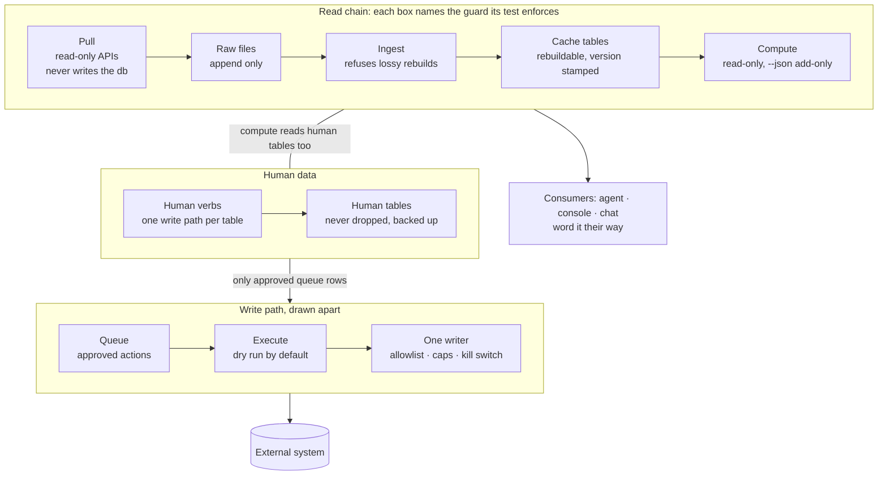
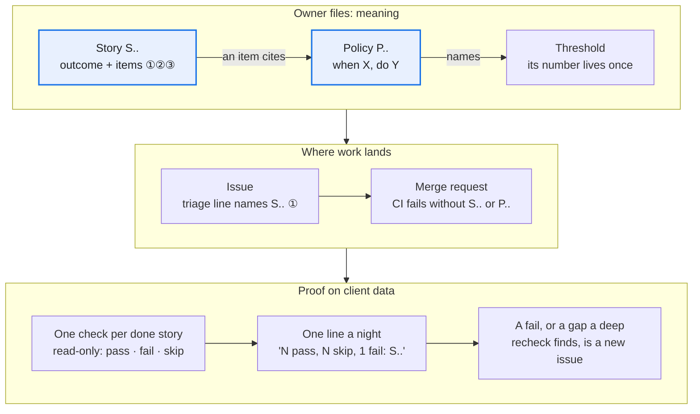
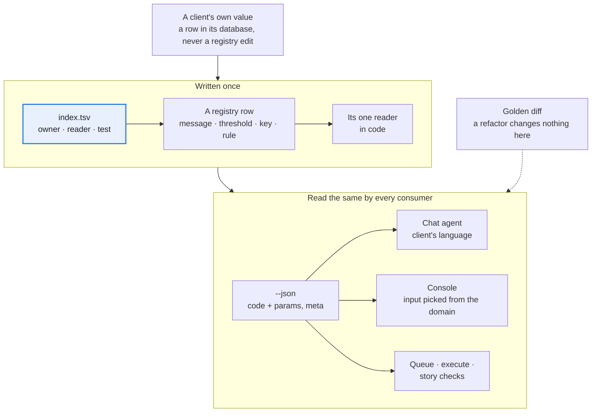

# Rules a harness holds

Moved from the playbook's [README](../README.md) unchanged; the README keeps the overview.

## Data layers and their guards

The first bugs in the source project were silent data loss with green tests, so every layer gets its guard test on day one.

Cache tables can always be rebuilt from raw; human tables never can, so they are kept apart, backed up before each ingest and written by one verb each.

The guards are code the kit holds: [`kit/db.py`](../kit/db.py) (human tables, rebuilds, the version stamp) and [`kit/raw.py`](../kit/raw.py), [`kit/atomic.py`](../kit/atomic.py), [`kit/single_instance.py`](../kit/single_instance.py), [`kit/retry.py`](../kit/retry.py) (raw that only grows, atomic writes, one run at a time, throttling recorded as gaps). How a pull merges into raw is in [docs/lessons.md](../docs/lessons.md). Each of their tests was shown failing on a broken copy of its guard.

*Paid for:* a rolling window moved between a schema change and the ingest, so raw held as many days as the table, but later ones. The count matched and the rebuild dropped the oldest days. Compare the set of days, not the count.

**The CLI is the only door.** Every capability the harness owns, each paid or live API call included, is a CLI verb with `--json`, a cost estimate where money is spent, and a `source` on what it writes. An agent may read through MCP or UI tools, but the result enters a workspace only through a `pull` or `import` verb. Hand-written raw files and direct API writes are violations. Otherwise the cost guard, the source tags and the network-free tests cover only the calls that happened to use the verb. *Example:* an SEO harness lets the agent read Search Console through an MCP, then lands the reply with its `import` verb, so the read is recorded like any pull.

**A page the harness delivers is drawn by the harness.** Every page, sample or demo a harness hands a person (an owner's review page, a client's draft, a design demo) comes from one of its own verbs, from the data it holds or, for a demo, a synthetic fixture, and is written where the harness writes pages. A link to a page published from a chat session (a hosted artifact) is for looking at something locally while debugging. It is never the deliverable, and it is never written into a file that ships (a skill, a doc, a template, a verb's own text): the cloud agent installs the harness from git and gets its verbs and its shipped files, so a hosted page cannot be drawn again, drifts from the code, and is missing exactly when the agent needs it. The check is [`kit.guards.pages`](../kit/guards/pages.py) (pack `testkit`): it reads what `git archive` ships and names each file and line that holds a hosted-artifact link, escaped or wrapped or not. It bans the link only; that the page really comes from a verb is the harness's own test of that verb. A link in an internal (export-ignore) file is fine; a shipped one that has to stay is an `allow` row with its reason, and a stale row is a problem. A harness opts in with `run(suites.page_links(ROOT))` in a test of its own (`suites.page_links`; no generated harness runs it by default). *Seen once:* the video-ads harness (owner decision, 2026-10-13): its plan-map page is drawn by its own verb, which superseded a hand-made page, and its synthetic demo is drawn by a tool of the harness.

**Teach the agent from `--help` and one first call.** End every verb's `--help` with two or three example calls (minimal, typical, one with a cost or gate flag) and the top-level keys of its `--json` output, and test both. Give the agent one status verb to call first in every session: the next step, what waits on a human, how old the last ingest is, and what has been spent. Anthropic's engineering post on advanced tool use reports that worked examples raised accuracy on complex parameters from 72% to 90%, and its post on effective harnesses for long-running agents has each session begin by reading the state left behind. *Built in the kit (0.6.1):* a verb declares `examples` and `keys` in its verb table row, its `--help` ends with them and `verbs --json` lists them, and doctor names the verbs that have none ([code](../kit/verbs.py)); the KOL harness fills them for every verb and runs each read verb's examples in a test. *Not yet proven here:* no accuracy gain has been measured, and the one status verb is built only in that harness, not in the kit.

**A partial pull is filed apart and flagged.** A paid pull asked with a filter (only the keywords holding the client's terms, say) gets its own series key and file, and its rows are ingested with a flag. So no report reads it as the whole footprint. A report reads it only where a confirmed decision says to (a segment, below), and says so. On a row both pulls hold, the unfiltered one wins. *Seen once:* the SEO harness's topic-filtered ranked-keyword pull (`scripts/pull_dataforseo.py`, `scripts/ingest.py`, `scripts/_lib/analysis.py`; `tests/test_relations.py`).

**An overview runs each report's own build and adds nothing to it.** One read-only compute runs every report's build in-process, with the same rules and registries, and keeps a summary per section: its status (`ok`, or `no_data` with the failure's code and `next`), the command for the whole report, its sources and its coded warnings. A section that fails never drops the document. A new number in it (a share of a total) is flagged as an estimate. Presentation stays with the consumer. The agent renders it, and an owner's console may draw it as a read-only page: no form, the command folded away (U01), outside links as U12 says. *Seen once:* the SEO harness's `scripts/compute_overview.py` (`tests/test_overview.py`) and its console's insights page (`webconsole/serve.py`).

**A datum a later decision needs is built from all of raw, never from the newest snapshot alone.** A table that reads only the newest pull or crawl forgets whatever that pull no longer sees: after a site moves, the new site's crawl no longer names the old URLs, and their clicks, links and redirects drop out of every report. So ingest builds such a cache table from every raw file that ever named a row, keeps each observation with its time, and takes the row's state from the newest observation. A state an object moves through (proposed, decided, written, verified or broken) is derived on each read from the rows that prove each step: a decision, an archived write and its undo, a check after the write. Nobody has to move it, and its rule names no platform: a new platform's writes join it by archiving the same record shape. *Seen once:* the SEO harness's URL inventory (`scripts/_lib/inventory.py`, the cache tables `site_urls` and `redirect_writes`; `scripts/compute_redirects.py`, its `lifecycle`; `tests/test_url_inventory.py`; its S52, owner decision 2026-10-14). On its first client, the redirect map grew from 123 rows, 37 never checked, to 382 rows, none unchecked.

## Human-in-the-loop rules

The owner decides less, but every decision is real.

1. **Decision rights live in the repo**, enforced by protected paths, not by an agent's memory.
2. **Trust lives in the data.** Values are pending or confirmed with a source; anyone may lower trust, only a human raises it; every rule reads confirmed first.
3. **Each story names its human step** (none / confirm / approve). Anything that can spend money is never "none".
4. **One gate for every channel**, bound to exactly what was shown, single use, logged, no bypass flag ([code](../kit/human.py)). Who signed is derived from the process's OS account (its passwd entry), never from `LOGNAME` or `USER`, which whatever launched the process can set to anything; a third party confirming their own value (`--for-client`) has its own name in the code's subject, so neither side's code passes for the other's. *Paid for:* two rounds. The first guard only checked that stdin was a terminal, so an agent wrapped the call in a pseudo-terminal, confirmed live values and signed them as the owner with a free-text source; then a relayed code approved a different pair of items than the one shown, confirmed another entity's value, and worked twice inside its window. A write that leaves the harness on a person's chat yes also keeps that person's own words as sent (`--relay-quote`; `need_quote` in [`kit/human.py`](../kit/human.py)): the code proves they saw the summary, the words show what they said to it. One yes is quoted for one code only: it never covers the next write, and a wave that needs one yes gets one scoped approval (rule 12), never a code per write the agent fills in itself. *Not yet proven:* in the SEO harness one "1. 同意" was quoted for eleven store-write codes and nobody saw the eleven diffs; no harness refuses a reused quote yet. Ask who to record as the relay user before the first such write, since that record is never rewritten. *Seen once:* the SEO harness's store write (`scripts/apply_shopify.py`, `gate()`; `tests/test_apply_shopify.py`), on an owner decision.
5. **Approve is the last human act before money moves.** A second confirm at execute only trains rubber-stamping. A write whose content is made after the approval is another case: the gate there binds bytes the approval never saw ([Writing into someone else's system](#writing-into-someone-elses-system), rule 2).
6. **Business "not yet" beats technically ready.** Client writes and paid calls stay off until the owner says so in writing, with a cap.
7. **Budget the owner's attention:** at most 10 asks, each with evidence, a recommendation and what "no" means. Inputs are picked from a list; the one thing typed is a value the harness validates.
8. **Agree in advance which channel counts.** Widening what may be written counts only when typed in chat, not clicked on a page. The one exception is an owner's mode switch ([L3](autonomy.md#the-levels)): the page asks the person to retype the value the gate binds (the number of days), the harness's confirm verb gates it, and it expires and is capped. *Seen once:* the SEO harness's S47, on the owner's decision (2026-10-13).
9. **Remote agents never act for the owner.** They install only on the owner's own "confirm vX" and end with a checklist report.
10. **Two refusals mean stop.** After two consecutive refusals from the gate or the cost cap, the verb answers with an `escalate` code; the agent stops and asks the owner and never looks for another door. Anthropic's engineering post on Claude Code auto mode found users approved 93% of prompts, so approvals are scarce and an agent that routes around a denial is the failure to design out. *Not yet proven:* no harness here counts refusals yet.
11. *Not yet proven:* **measure whether the gate is real.** Track how often the owner overrides each kind of ask. The console records with every answer whether it took the suggestion, but no override rate per kind of ask is computed yet. An eval counts only if it fails when its rule is removed: cut once, 5 of 9 failed as they should, and the other 4 stay only as regression guards. The offline half now ships: `kit/guards/evals.py` holds each case to a rule of SKILL.md, the forbidden-verbs pattern generated from the verb table, and an ablation row ([templates/evals/](../templates/evals/)).
12. **A gate the human clicks through proves nothing: tier changes by what the harness can see.** The harness, not the agent, classifies each change from the diff of the live object against the new file. A routine, reversible kind (internal links, a cover image, a meta title) gets one approval per wave that is capped (writes per item and per week), expires, and is frozen to its scope when the work is proposed; a change outside the scope, over a cap or past the date is refused and asked. Per-change proof stays only where the change is public or irreversible (publish, a redirect, a translation, body text), and every revert still asks. Each covered write records which approval it rode on, and the owner sees the last days' list with its undo commands. The approve checkboxes start unticked. *Paid for:* the owner of the SEO harness said the per-item approvals had become a rubber stamp: eleven items approved in one click, then a code per write the agent relayed itself. *Seen once:* that harness's S46 (`seo plan add --allow links,image,seo`, `ssot/apply_tiers.tsv`, `scripts/apply_shopify.py`; `tests/test_apply_shopify.py`). This rule is L2 of the [autonomy levels](autonomy.md); the owner-switched mode above it is L3, and the shared mechanics are [`kit/autonomy.py`](../kit/autonomy.py).
13. **An open question never holds the plan.** What the harness cannot answer yet is recorded, not waited on. Each open question names `by_data`, the data that can answer it without asking anyone once the harness holds it (a kind from the harness's own closed list, or `ask_only` when only a person can), and `meanwhile`, what the plan does until then. `meanwhile` is an action, never a wait: "write the template and make no video" passes, "TBD" or "wait for the client" does not (the check catches the obvious waits, and a short text that opens with "hold" or "pause" too; a reviewer reads the rest). When the data arrives the harness prompts a read-back: each unanswered question that data can answer is listed with the data's fingerprint, until the answer is recorded or the agent records the fingerprint it read; a new version of the data prompts again. The owner is asked only what no data can answer. The check is [`kit.questions`](../kit/questions.py) (pack `learning`): `problems()` on the harness's rows in its tests, `readback()` in the verb that learns from new data, `self_test()` planting each break. *Seen once:* the video-ads harness (owner decision, 2026-10-13): its client rarely knows such answers, while the results file the client sends back can answer some. Its questions carry both fields (a `meanwhile` there reads "say nothing about direct dispatch, free shipping or price in the ads" or "write the template, make no video"), its insight page groups them (the data will answer, only a person can, no data named, answered), and it warns once the results file it names holds this project's creatives.

## Writing into someone else's system

The kit's executor ([`kit/execute.py`](../kit/execute.py)) sends queue items whose payload was known when they were approved. Some writes carry content made later: an approved topic becomes an article only after the approval. The SEO harness's store write (`scripts/apply_shopify.py`, `tests/test_apply_shopify.py`) puts such work into a client's online store: a hidden draft, then publish, then unpublish if asked. Its rules carry to any harness that writes into a system someone else owns. *Seen once:* that harness, on an owner decision (2026-10-12).

1. **Only approved work, of the one kind the door may write.** Anything else is refused before any call: an item nobody approved, a target that already exists, a file missing a required field. A dry run checks all of it and writes nothing.
2. **The gate binds what the write will change, as it is now.** Content made after the approval is bound by its file's sha256, so a changed file needs a new confirmation. A change of state (publish, unpublish) is bound to the live object as read just before it, so an edit someone made in the system after the code was issued needs a new code. This is not a second confirm of the same thing (rule 5 above): the approval saw a topic, and the gate sees the bytes.
3. **Stage hidden, preview in place, then publish.** The first write is invisible (a hidden draft). The person previews it in the system itself, from a link the verb prints. Making it visible is its own gated write. Where the person cannot preview in place (no login to the system), an owner's mode ([L3](autonomy.md#the-levels)) may draft and publish in one step for its eligible kinds only, the draft read back as written first; the code-free undo stands in for the preview (seen once, the SEO harness's T14, 2026-10-13).
4. **Archive every write under raw, never rewritten.** Keep the bytes sent, the system's replies verbatim, the object read back afterwards, and a manifest: who, the reason, the content hash, whether it verified, and the cost. The archive is the door's record. The door writes no database row: the work item's status moves through its own human verb, which the output names as `next`.
5. **Read back and say so.** After each write, read the object again and compare it with what was meant. A mismatch is a coded warning and a non-zero exit, never a quiet success.
6. **Revert is the inverse write, never a delete.** Unpublish hides what publish showed. Nothing the door wrote is deleted, so every state can still be read back and restored.
7. **The right to write binds to a host, never to a switch that travels with a copy.** A database gets copied: a snapshot restored on a laptop, a second workspace for a test. An on/off flag inside it, or a line in an agent's brief, goes along, and the copy writes to the live system. So the right to write is a fact naming one host id (the machine's name and the real path of the workspace: neither is a secret, and neither travels with a copy), checked before every door's first write; a dry run and a read are never refused. As with every level of trust ([autonomy](autonomy.md#rules-at-every-level), rule 3), an agent may narrow it at once, and only the owner's confirm moves it to another host or clears it. A renamed machine or a moved workspace is another host: writes stop until the owner confirms the new id. The doctor prints this host's id, and every write's record names it. *Seen once* (the SEO harness, 2026-10-14): its fact `write_host` (`scripts/_lib/write_host.py`; `tests/test_apply_shopify.py`; its S34 and S47).
8. **One gate for every platform, and an adapter per platform row; extract the gate when the second platform arrives, not before.** The gate is the same whatever the system: the proofs, the approvals and caps counted from the archive, the host check, the tiers, the archive and the undo bookkeeping. An adapter knows only what to write, how to read it back, and its own verbs. A client's platform is a fact read against a registry row (its pull and apply verbs, its undo, its content model), so a new platform is a row and an adapter, never a branch inside the gate. With one platform the gate lives in its adapter; the second shows where the seam is. Extract it then, with the first adapter's behaviour pinned: its help and its write records unchanged, byte for byte. *Seen once* (the SEO harness, 2026-10-14): its `scripts/_lib/apply_gate.py` (`Door(platform)`), its adapters `scripts/apply_shopify.py` and `scripts/apply_astro.py`, and `ssot/site_platforms.tsv` (its S51). Its first cut of the second adapter imported the first and swapped a module-wide platform in and out. The extraction passes the platform explicitly.

## What an agent judges

An agent judges what no registry decides: is this site a competitor, which words define the business. The harness cannot make that judgement, but it can make it checkable, keep every answer, and keep a "no" findable. *Seen once:* the SEO harness, on an owner decision (2026-10-12).

1. **A judgement quotes its evidence, and the harness checks the quote.** The agent's reason carries the page's own words (`--quote`). The harness finds each quote word for word in the copy of the page it kept under raw, or refuses the write and records nothing. Markup, entities, spacing, case, and dash and quote-mark styles are normalised. Inline tags are dropped without a space, so `<b>vacuum</b>.` reads `vacuum.`. Words that only a script or style holds are not on the page. *Paid for:* on the first real page, inline tags read as a space put a space before a full stop, and an exact quote was refused. (`scripts/_lib/human_tables.py`, `check_quotes`; `tests/test_relations.py`)
2. **Classify an outside party by where it sits in the value chain, apart from the switch that analyses it.** The SEO harness's closed set: `peer_full`, `peer_segment`, `downstream_customer`, `downstream_channel`, `upstream_supplier`, `ecosystem`, `unrelated`. It is a pending value until a human confirms it, like the `competitor` value beside it, which still decides whether reports analyse the party. A "no" stays a row. A read-only console page lists every judgement along the chain, confirmed, pending and rejected, so a wrong "no" can be found and turned around. (`ssot/decision_keys.tsv`, `webconsole/serve.py` `/relations`; `tests/test_webconsole.py`)
3. **A large group competes on a segment, not as a whole.** A confirmed decision names the URLs or paths it competes on, per market (a group runs a site per country). Reports then read only that group's rows on those URLs. Without it they read the group's whole footprint, never a filtered pull. (`segment_urls`; `scripts/_lib/analysis.py`)

## Stories that prove themselves

The owner can't read code, so "approved" and "done" must rest on checks a machine already ran.

1. **Stories and rules are separate owner files** ([how](../templates/ssot/README.md#stories-and-policies)). *Paid for:* an audit found four rules the code applied that nobody had approved; the owner approved them one by one.
2. **Acceptance items are numbered invariants a machine can check:** children sum to the parent, missing input means "unknown", a zero row never disappears. Issues and MRs cite the item (S.. ①). Such items let a read-only agent find a headline ratio dividing 30 days of spend by 23 days of sales.
3. **The story id is enforced in CI, not in instructions** ([template](../templates/ci/gitlab-ci.yml)). *Paid for:* 17 of the first 105 MRs named no story, 15 of them refactors; after a 15-line CI job on the title, none of the next 77. Give refactors a guarantee story to name.
4. **One read-only check per done story; missing data skips, never passes** ([template](../templates/ssot/story_checks.tsv)). *Paid for:* a "nothing sent without approval" check first passed on a client that had never sent anything. *Built* (its own story still awaits the owner); the nightly run on the host is not yet seen.
5. *Seen once:* **nightly checks prove presence; deep rechecks prove behaviour.** Read-only agents walked the stories item by item on a sandbox copy: 8 pass, 21 partial, 9 blocked of 38 judged. The worst: a code shown for items A and B approved A and C, unit tests green. No nightly row checks that binding.
6. *Seen once:* **audit the map both ways, then test its links.** Story → code and code → story found 17 unstoried features, 9 stale stories and 4 rules only the code knew, each put to the owner. Later, 4 of 5 partial stories named a closed blocker.
7. **"Done" for an object written into someone else's system is a fixed checklist, recomputed from fresh data.** A write that read back ([the write door](#writing-into-someone-elses-system), rule 5) is not yet done: the system, and the search engine or marketplace behind it, still have to show it. Every object the harness wrote gets the same checks, each `pass`, `fail` or `unknown` with the command that gets the missing data. A check whose data is older than the object's last write is `unknown`, never the old `pass`. The object is closed when every blocking check passes; a check that is only a convention warns and never blocks. A slow outside system (a sitemap the platform rebuilds on its own, an index that takes days) gets no assumed delay: after a set number of days a due list names each live object still `unknown` or failing there, with its exact commands. The work item closes with its object: a closed object whose item is still open puts the item's close into `next`, and an item marked done while its object is open is a coded warning, since it was closed from memory. A version is done when every object nobody withdrew is closed. *Seen once:* the SEO harness's post-publish checklist for blog articles (`scripts/compute_published.py`, its due list `published_recheck_days` after the write; `tests/test_published.py`; its S43 and S48), after the owner asked whether publishing was really closed: only a closed loop lets anyone say a version is done.
8. **Parallel sessions append to the story files: merge them by union, take the next id from a command, generate the roadmap page instead of committing it.** *Paid for:* one evening of four hand-resolved merge conflicts on the two story tables and the generated roadmap page, and two id collisions between sessions (a block of ids taken twice, one id taken by two merge requests). `.gitattributes` marks both story files `merge=union` (two appended rows both stay; a clash shows as a duplicate id, which the registry test refuses); a ten-line script reads the largest id on the working tree and every local and remote branch, open merge requests included, and prints the next; the page is built on demand and ignored, with CI checking only that every story is on it. *Built* in the SEO harness (`scripts/story_next.py`, story S146).
9. *Seen once:* **stories are the builder's record; they do not belong in anything a client can read.** The story tables name clients, their sites and what was decided for them, so they describe how this harness was built, not what it does for a client. Today the harness checkout is cloned onto client hosts, so the files travel with it; the owner accepted that risk for now (2026-10-15). The way out, when a client reads the repository: keep the build record in its own repository, or ship releases without `ssot/user-stories*.tsv` and the roadmap page. A client's own facts, decisions and plan stay in that client's database ([registries](#registries-one-place-per-value), rule 9).

## Registries: one place per value

A value lives in one registry row with one reader, so every agent, page and check gets the same answer, in the client's language.

1. **Code every message and close the registry both ways, on every verb** ([how](../templates/ssot/README.md#message-codes)). *Paid for:* the gate and write verbs sat outside the test, so their refusals reached the owner's page as "unclassified" until about 40 were coded. The reader and the checks are [`kit/messages.py`](../kit/messages.py) and `check_verbs` in [`kit/guards/json_contract.py`](../kit/guards/json_contract.py).
2. **A threshold enters only with a reader and is renamed only through a map** ([how](../templates/ssot/README.md#thresholds)). *Paid for:* one owner audit merged 4 duplicates, dropped 3 that nothing read and renamed 3; no client folder needed a migration.
3. **Type every key a human or agent can set** ([how](../templates/ssot/README.md#facts-and-decisions)). *Paid for:* a percentage typed as 15, .15 or 150 silently changed every margin. Bounds now refuse 150 on a 0–100 percentage and 80 on a 0–1 ratio; 15 and .15 both still pass, so state the unit where it is typed.
4. **`meta` is the truth label, scoped to exactly what the report covers:** window asked vs found, missing days per source, stale sources, what-if values in effect. Queue and execute read it to refuse.
5. **Preview with a what-if flag, not a UI field.** A proposed threshold runs through any report, stored nowhere and echoed in `meta`; the queue refuses a what-if snapshot, and the console's "what confirming changes" comes from it alone.
6. **Alert rules are rows, and each new rule still needs code** ([how](../templates/ssot/README.md#alert-rules)). *Paid for:* the registry grew from 5 to 12 rules in six days, each with code for its grain, metric or comparison; the row is what makes a rule visible, named and tunable.
7. **Every number names its source, and a report takes one source per entity.** Each cache row carries `source`; a fixed preference order picks one source per entity and metric, and the report says which it used. A third-party estimate is never shown as the platform's own number, and two sources are never blended into one figure ([bug class](../templates/bug-classes.md#pulls-and-platform-facts): `blended-sources`). *Seen twice:* both source harnesses do this by design: an ads harness never treats a seller-tool estimate as the marketplace's truth; an SEO harness ranks the search engine's own clicks above any tool's traffic estimate.
8. **A graded rule cites the platform's own documentation; a convention is marked and capped** ([how](../templates/ssot/README.md#cited-rules)). Each check row names the page that makes it a rule (`basis=authority`); an industry habit is `basis=heuristic` and a test keeps it at the lowest severity. Re-check the citations against the live pages from time to time: they rot. *Paid for:* five days after an SEO harness wrote its check registry, a re-check of its 30 cited pages found 8 rows to fix: 5 pages had moved to a new docs tree (and a test that pinned the old prefix failed), 3 cited pages did not say what the row claimed, and one end date was a day off.
9. **`ssot/` is the builder's; what a client sets lives in that client's database.** The registries and their defaults belong to whoever builds the harness. What a client sets or decides through its agent (its own thresholds, its picks) is a row in that client's own database, never an edit of `ssot/`: one repository serves every client, so a client's choice has to travel with its data, keep its history and never reach another client. That includes a client's vocabulary: the options a harness mines or proposes for one client (a creative dimension's values, words taken from its own or its competitors' ads) are that client's values, rows in its database that a person there confirms or retires; `ssot/` keeps the harness's schema (the axes and their code letters) and the generic seeds a builder writes for every client. A harness reads it in one of two ways. Either the kit's confirmed `threshold_<name>` facts, which `Thresholds` puts over the TSV default ([`kit/registry.py`](../kit/registry.py)), or its own append-only settings table, where the newest row for a key stands (going back to the default is a row too), read over the `ssot/` default. Either way a value the registry's bounds refuse is refused when it is written and again when it is read, since a bound may have moved in between. `check_writes` in [`kit/guards/ssot.py`](../kit/guards/ssot.py) (in `kit.testing.suites.ssot`; a harness with its own ssot test adds `suites.run(suites.ssot_writes(ROOT))`) fails on harness code that writes under `ssot/` and names the file and line, never what is written. A builder's own tool that may write there (a registry editor) is named in `[guards.ssot].writers` with its reason. *Seen once:* a video-ads harness, whose creative-space thresholds default in its constants registry while a client's own value goes through a `set` verb into an append-only table of that client's database (owner decision, 2026-10-13); the same harness then moved its creative dimensions' values, most of them mined from one client's ads, out of its registry into that client's database, keeping the axes in `ssot/` (owner decision, 2026-10-13).
